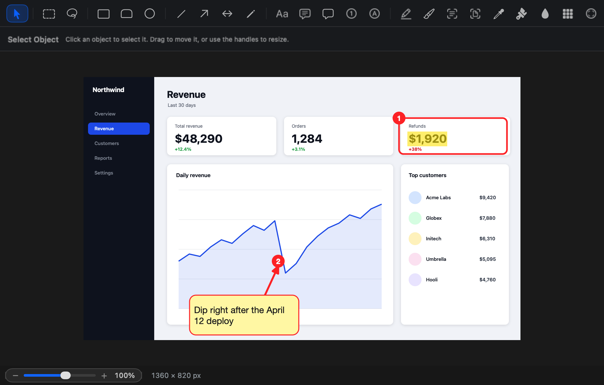
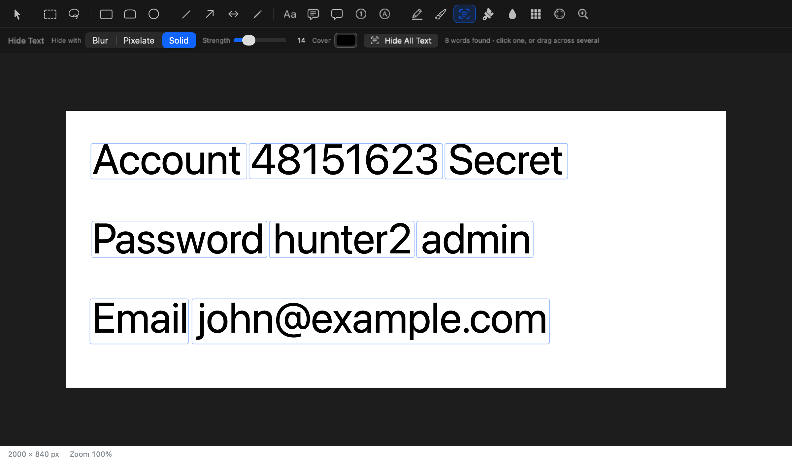
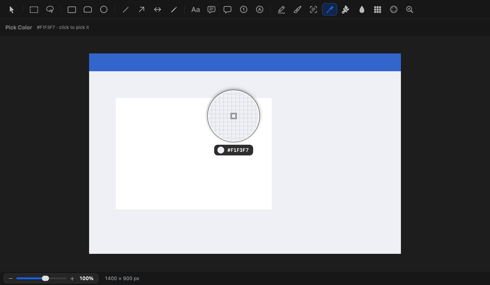

<p align="center">
  
</p>

<h1 align="center">CaptureDeck</h1>

<p align="center">
  A native macOS screen capture tool with a built in editor. Capture, mark up, hide the sensitive bits, share.
</p>

<p align="center">
  
  
  
  
  
  
</p>

<p align="center">
  
</p>

## About

CaptureDeck is a pet project. I wanted a screenshot tool that lives in the menu bar, stays out of the way, and has an editor good enough that I never need to open a second app. It grew from there into a fairly complete tool, and it is also where I practise building a larger native Mac app in Swift: multi module packages, system frameworks, real permissions, and a proper test suite.

It runs entirely on your Mac. Nothing is uploaded and there is no account, analytics or network code.

## Features

**Capture**
- Region, active window, full screen and all displays
- Fixed size regions
- Multi display captures with a divider and a "Screen 1", "Screen 2" badge on each display (optional)
- Scrolling capture that detects the scroll direction, starts from wherever the page already is, and stitches the result into one tall or wide image
- Frozen screen with a red frame around the window you are about to capture
- Global hotkeys, all configurable

**Edit**
- Rectangles, rounded boxes, ellipses, lines, arrows (with several head styles), pencil with smoothing, text, callouts and numbered steps
- Select anything and move, resize or restyle it, with handles on line endpoints
- Hide Text: on device OCR finds every word, click or drag to blur, pixelate or cover it
- Redact brush for anything that is not text
- Eyedropper with a magnifier, paint bucket with live preview, rectangle and freehand selection
- Quick crop by dragging the edges of the selection
- Smooth zoom from 5% to 800%, full undo and redo

**Output**
- Copy to clipboard, save to a folder, or both
- Optionally close the editor right after you copy from it
- Filename templates, PNG or JPEG
- Launch at login, capture sound, start minimized

<p align="center">
  
  
</p>

## Install

Download the latest `.dmg` or `.zip` from the [Releases](../../releases) page, drag CaptureDeck to Applications and open it. The icon appears in the menu bar.

The app is not notarized yet because I do not have a paid Apple developer account for this project. On first launch macOS may block it. Right click the app, choose Open, and confirm. You can also allow it under System Settings, Privacy & Security.

Permissions CaptureDeck asks for:

| Permission | Why |
| --- | --- |
| Screen Recording | To capture the screen |
| Accessibility | Only for scrolling capture, to scroll the window and to ignore the stop click |

## Build from source

You need macOS 13 or later and Swift 6 (Xcode or the Command Line Tools).

```sh
./scripts/setup-dev-signing.sh   # optional, once: stable local signing so permissions survive rebuilds
./scripts/test.sh                # run the test suite
./scripts/build-app.sh           # builds build/CaptureDeck.app (universal arm64 + x86_64)
./scripts/package-release.sh     # builds dist/CaptureDeck-<version>.dmg and .zip
open build/CaptureDeck.app
```

## How it is put together

The code is split into small Swift package modules so each part can be tested on its own.

| Module | Responsibility |
| --- | --- |
| CoreModels | Shared types, app version info |
| DesignSystem | Colours, spacing and shared UI pieces |
| CaptureEngine | ScreenCaptureKit capture, region picking, scrolling capture and image stitching |
| EditorEngine | Document model, annotation shapes, rendering, redaction, text detection with Vision |
| EditorUI | Canvas, tools, ribbon and the AppKit event handling |
| Platform | Clipboard, file saving, hotkeys, login item |
| Settings / SettingsUI | Typed settings store and the SwiftUI settings window |
| CaptureDeck | The menu bar app that wires everything together |

Some things I enjoyed solving along the way: stitching scrolling screenshots by matching overlapping rows, keeping the editor responsive with live blur and pixelate previews, and driving the real app from tests to catch input and focus bugs that unit tests miss.

## Tests

About 390 tests using Swift Testing cover the stitcher, annotation geometry, image operations, settings, file naming and the editor tools, including rendered UI snapshots.

## Roadmap

- Notarized release builds
- Screen recording to GIF and video
- Annotation presets and a recent captures shelf
- Share extensions

## License

Released under the [MIT License](LICENSE).

## Author

Built by Jahidur Rahman ([@jhrahman](https://github.com/jhrahman)).
