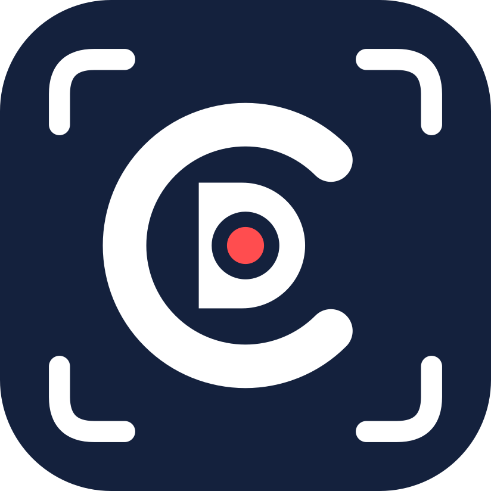
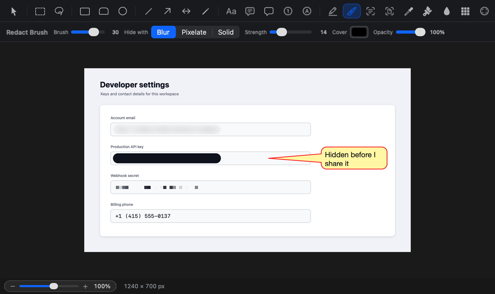
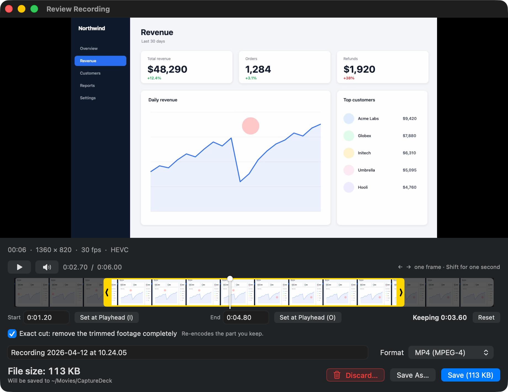
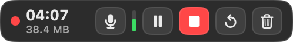
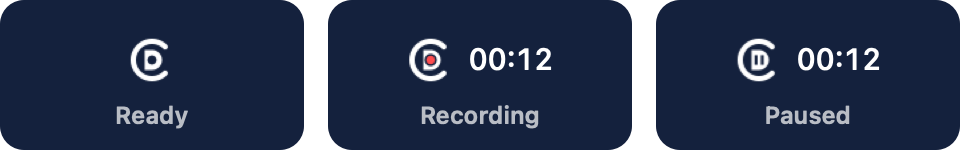
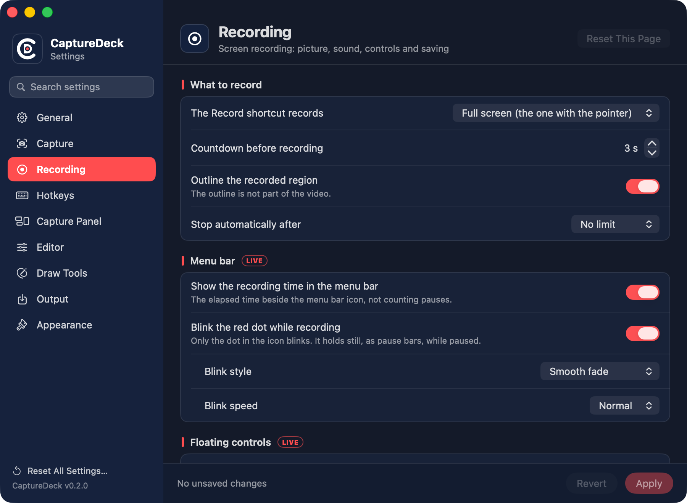
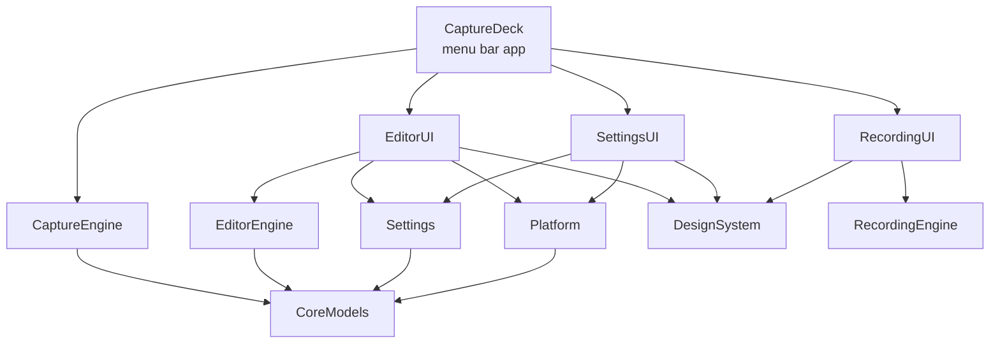

<p align="center">
  
</p>

<h1 align="center">CaptureDeck</h1>

<p align="center">
  <b>Capture it. Mark it up. Record it. Hide what shouldn't leave your Mac.</b><br>
  A native screenshot and screen recording app for macOS, with an editor that does more than it needs to.
</p>

<p align="center">
  <a href="https://github.com/jhrahman/CaptureDeck/releases/latest/download/CaptureDeck.dmg">
    
  </a>
</p>

<p align="center">
  
  
  
  
  
  <a href="LICENSE"></a>
</p>

<p align="center">
  <a href="USER-GUIDE.md"><b>📖 User Guide</b></a>&nbsp;&nbsp;·&nbsp;&nbsp;
  <a href="#-screenshots">Screenshots</a>&nbsp;&nbsp;·&nbsp;&nbsp;
  <a href="#-text-recognition-ocr">OCR</a>&nbsp;&nbsp;·&nbsp;&nbsp;
  <a href="#-screen-recording">Recording</a>&nbsp;&nbsp;·&nbsp;&nbsp;
  <a href="#-shortcuts">Shortcuts</a>&nbsp;&nbsp;·&nbsp;&nbsp;
  <a href="#-install">Install</a>&nbsp;&nbsp;·&nbsp;&nbsp;
  <a href="#-build-it-yourself">Build</a>
</p>

<p align="center">
  
</p>

I started CaptureDeck as a weekend project because I kept opening a second app every time a screenshot needed an arrow or a blurred password. It has since grown into the tool I actually use all day. It lives in the menu bar, runs fully on your Mac, and has no account, no analytics and no network code.

---

## ✨ At a glance

<table>
  <tr>
    <td width="33%" valign="top">
      <h3>📸 Capture</h3>
      Region, window, full screen, freehand, fixed size, every display at once, or a whole scrolling page.
    </td>
    <td width="33%" valign="top">
      <h3>✏️ Edit</h3>
      Arrows, shapes, bubbles, numbered steps, text, highlighter, spotlight, magnifier, crop and resize.
      <br><br><b>🔤 OCR</b> built in: copy text from the screen or a picture.
    </td>
    <td width="33%" valign="top">
      <h3>🎬 Record</h3>
      Screen, region or window, with system sound and microphone. Trim, check the size, then save.
    </td>
  </tr>
  <tr>
    <td valign="top">
      <h3>🙈 Hide</h3>
      Click a word to cover it. Text is read on your Mac, so it never leaves it.
    </td>
    <td valign="top">
      <h3>⚙️ Make it yours</h3>
      Searchable settings, your own shortcuts, file name templates, light and dark modes.
    </td>
    <td valign="top">
      <h3>🔒 Private</h3>
      No account. No analytics. No network code.
    </td>
  </tr>
</table>

---

## 📸 Screenshots

- **Captures what you point at.** The screen freezes first, and the window you are about to grab gets a red frame.
- **Scrolls for you.** Click a long page and it glides down (or sideways) on its own and stitches one tall or wide image. You choose the speed, and your pointer stays free to click **Done**.
- **Edits right away.** Add what you need, and pick any object later to move or restyle it.
- **Picks colors properly.** Right-click any color box to take a color from anywhere on screen. See HEX and RGB values, or fill an area with the paint bucket, even with transparency.
- **Hides secrets.** Click words to blur, pixelate or cover them, or paint over anything with the redact brush. For real secrets, use a solid cover.

<p align="center">
  
</p>

---

## 🔤 Text recognition (OCR)

| | |
| --- | --- |
| ⚡ **Capture Text** | Press `⌃⇧T`, drag a box, and the words are on your clipboard |
| 🖱️ **Extract Text tool** | Click a line or drag a box in the editor, or copy it all |
| ▦ **QR codes and barcodes** | Their contents are read too. Links are never opened for you |
| 📝 **View and edit** | Correct the text, then copy it or save a text file |
| 🔎 **Searchable PDF** | Looks like your picture, with words you can search and select |
| 🙈 **Respects covers** | Text behind a solid cover in the editor is never read |
| 🌍 **Your way** | Automatic or chosen language, line breaks and spelling correction |

It runs on your Mac, using Apple's Vision framework.

---

## 🎬 Screen recording

<p align="center">
  
</p>

| | |
| --- | --- |
| 🖥️ **What** | A full screen, a region, a window, or the same region as last time |
| 🎞️ **Picture** | Native resolution, 15 to 120 fps, in HEVC, H.264 or ProRes |
| 🔊 **Sound** | The Mac's sound and your microphone, in one track or two |
| 🖱️ **Teaching aids** | A circle around the pointer, click ripples and shortcut labels, in your colors |
| ✂️ **Trim** | One timeline, or type exact times. **Exact cut** removes trimmed footage completely |
| 💾 **Save** | MP4, MOV or GIF, with the file size shown before you save |
| 🛟 **Safety** | If the app closes unexpectedly, your recording is offered back |

Small floating controls sit beside the Dock and stay out of your video. You can pause, mute, start over or discard.

<p align="center">
  
</p>

The menu bar icon shows what is happening at a glance. While recording, only its red dot blinks.

<p align="center">
  
</p>

---

## ⚙️ Settings you can actually find

A sidebar in the brand's navy, search across every page (`⌘F`), and nothing changes until you press **Apply**. Many recording options can be changed while you record.

<p align="center">
  
</p>

---

## 💛 Two small things I like

**Multi display captures label themselves.** Grab all your screens at once and the displays are set apart on a dark glass backdrop with a "Screen 1", "Screen 2" label under each one, so nobody has to guess which monitor is which. The screenshots themselves are never drawn on, and it is a setting if you would rather have them joined edge to edge.

<p align="center">
  
</p>

**Quick crop.** A new capture opens with everything selected. Drag any edge inward and it crops when you let go. Undo brings it back.

---

## ⌨️ Shortcuts

| Shortcut | Action | Shortcut | Action |
| --- | --- | --- | --- |
| `⌃⇧1` | Full screen | `⌃⇧6` | Fixed size |
| `⌃⇧2` | Region | `⌃⇧8` | Repeat last capture |
| `⌃⇧3` | Active window | `⌃⇧9` | All displays |
| `⌃⇧4` | Window or object | `⌃⇧S` | Scrolling window |
| `⌃⇧5` | Freehand | `⌃⇧0` | Show or hide the panel |
| `⌃⇧R` | **Start / stop recording** | `⌃⇧P` | **Pause / resume recording** |
| `⌃⇧T` | **Capture Text (OCR)** | | |

All of these can be changed. The [User Guide](USER-GUIDE.md#14-shortcut-cheat-sheet) also lists the editor keys.

---

## 📦 Install

1. Grab **CaptureDeck.dmg** from the badge above or the [Releases](https://github.com/jhrahman/CaptureDeck/releases) page.
2. Drag the app to **Applications** and open it. The icon shows up in your menu bar.

It is not notarized yet, so macOS may complain on first launch. Right click the app, choose **Open**, and confirm once. If there is no Open button, use **Open Anyway** in System Settings > Privacy & Security.

| Permission | Why |
| --- | --- |
| **Screen Recording** | So it can capture and record the screen |
| **Accessibility** | For scrolling capture, picking parts of a window, key labels in recordings, and placing the recording controls beside the Dock |
| **Microphone** | Only if you record your voice |

New here? The **[User Guide](USER-GUIDE.md)** walks you through everything.

---

## 🛠️ Build it yourself

You need macOS 13+ and Swift 6 (Xcode or the Command Line Tools).

```sh
./scripts/test.sh              # run the tests
./scripts/build-app.sh         # build/CaptureDeck.app, universal
./scripts/package-release.sh   # dist/CaptureDeck.dmg and CaptureDeck.zip
```

Tip: run `./scripts/setup-dev-signing.sh` once, so macOS keeps your permissions between builds.

---

## 🧩 Under the hood

Eleven small Swift modules, so each part can be tested alone. It is built on ScreenCaptureKit, AVFoundation, Vision, AppKit and SwiftUI, with no third-party packages.



<sub>Some direct links to the lower modules are left out to keep the picture readable. <code>Package.swift</code> has the full list.</sub>

| Module | What lives there |
| --- | --- |
| `CaptureEngine` | Screen grabbing, region picking, scroll stitching |
| `RecordingEngine` | Capture, audio, movie writing, trimming and export |
| `RecordingUI` | Floating controls, pointer effects, review and trim |
| `EditorEngine` | Document model, shapes, rendering, OCR, code reading, searchable PDF |
| `EditorUI` | Canvas and tools in AppKit |
| `Settings`, `SettingsUI` | One registry of settings, and the window built from it |
| `Platform`, `DesignSystem`, `CoreModels` | System services, the brand and theme, shared types |

The parts I enjoyed most: stitching scroll captures by matching overlapping rows, live blur and pixelate previews while you paint, and tests that drive the real editor to catch the focus and input bugs unit tests miss. There are more than 470 of them.

Brand artwork lives in [`CaptureDeck-brand-assets`](CaptureDeck-brand-assets).

---

## 🗺️ Next up

Notarized builds and a shelf of recent captures.

## 🤝 Contributing

Contributions are welcome. Read the [contributing guide](CONTRIBUTING.md) first, including its [terms](CONTRIBUTING.md#contribution-terms).

## 📄 License and author

CaptureDeck is **source-available** under the [Apache License 2.0 with the Commons Clause](LICENSE). Because it limits selling, it is not "open source" in the usual sense.

| You may | You may not, without the author's written permission |
| --- | --- |
| ✅ Use it, including at work | ❌ Sell CaptureDeck or a modified copy |
| ✅ Read, change and build the code | ❌ Charge for a product or service whose value comes entirely or mostly from CaptureDeck, including paid hosting or support |
| ✅ Share it for free, keeping the license notice | ❌ Remove the license notice |
| ✅ Contribute back | |

This table is only a summary; the [LICENSE](LICENSE) is what applies.

Built by [Jahidur Rahman](https://github.com/jhrahman).
