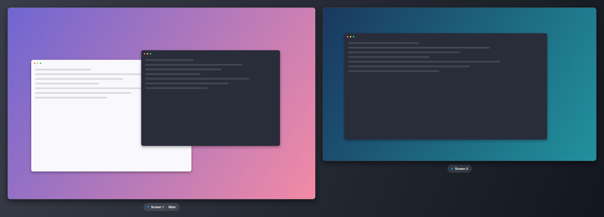

<p align="center">
  
</p>

<h1 align="center">CaptureDeck</h1>

<p align="center">
  <b>Capture it. Mark it up. Hide what shouldn't leave your Mac.</b><br>
  A small native screenshot tool for macOS with an editor that does more than it needs to.
</p>

<p align="center">
  <a href="https://github.com/jhrahman/CaptureDeck/releases/latest/download/CaptureDeck.dmg">
    
  </a>
</p>

<p align="center">
  
  
  
  
  
</p>

<p align="center">
  
</p>

I started CaptureDeck as a weekend project because I kept opening a second app every time a screenshot needed an arrow or a blurred password. It has since grown into the tool I actually use all day. It lives in the menu bar, runs fully on your Mac, and has no account, no analytics and no network code.

## What it does

- **Captures what you point at.** Region, window, full screen, fixed size, or every display at once. The screen freezes first, and the window you are about to grab gets a red frame.
- **Scrolls for you.** Click a long page and it scrolls on its own, in whichever direction the content goes, and stitches one tall (or wide) image.
- **Edits right away.** Arrows, boxes, callouts, numbered steps, text, pencil, highlighter, eyedropper, paint bucket. Pick any object later to move or restyle it.
- **Hides secrets properly.** It reads the text in the picture on your device, so you can click a word to blur, pixelate or cover it. Or paint over anything with the redact brush.
- **Stays out of the way.** Hotkeys for everything, clipboard and file output, filename templates, and an optional "close the editor after copy".

<p align="center">
  
</p>

## Two small things I like

**Multi display captures label themselves.** Grab all your screens at once and the displays are set apart on a dark glass backdrop with a "Screen 1", "Screen 2" label under each one, so nobody has to guess which monitor is which. The screenshots themselves are never drawn on, and it is a setting if you would rather have them joined edge to edge.

<p align="center">
  
</p>

**Quick crop.** A new capture opens with everything selected. Drag any edge inward and it crops when you let go. Undo brings it back.

## Install

Grab **CaptureDeck.dmg** from the badge above (or the [Releases](https://github.com/jhrahman/CaptureDeck/releases) page), drag the app to Applications and open it. The icon shows up in your menu bar.

It is not notarized yet, so macOS may complain on first launch. Right click the app, choose Open, and confirm once. CaptureDeck asks for two permissions:

| Permission | Why |
| --- | --- |
| Screen Recording | So it can capture the screen |
| Accessibility | Only for scrolling capture, to scroll the window and ignore the stop click |

## Build it yourself

You need macOS 13+ and Swift 6 (Xcode or the Command Line Tools).

```sh
./scripts/test.sh              # run the tests
./scripts/build-app.sh         # build/CaptureDeck.app, universal
./scripts/package-release.sh   # dist/CaptureDeck.dmg and CaptureDeck.zip
```

## Under the hood

Nine small Swift modules, so each part can be tested alone: `CaptureEngine` (ScreenCaptureKit, region picking, scroll stitching), `EditorEngine` (document model, shapes, rendering, Vision based text detection), `EditorUI` (canvas and tools in AppKit), `Platform`, `Settings` and `SettingsUI` (SwiftUI), `DesignSystem`, `CoreModels` and the menu bar app itself.

The parts I enjoyed most: stitching scroll captures by matching overlapping rows, live blur and pixelate previews while you paint, and tests that drive the real editor to catch the focus and input bugs unit tests miss. There are 390+ of them.

## Next up

Screen recording to GIF and video, notarized builds, and a shelf of recent captures.

## License and author

MIT, see [LICENSE](LICENSE). Built by [Jahidur Rahman](https://github.com/jhrahman).
