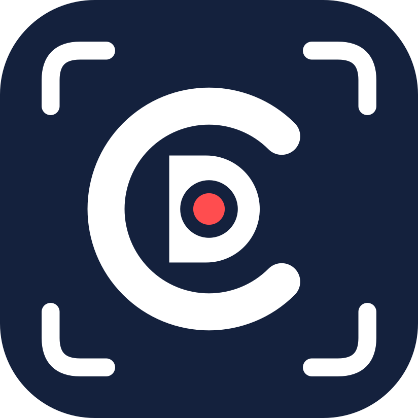
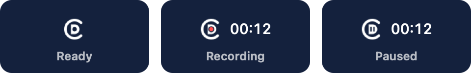
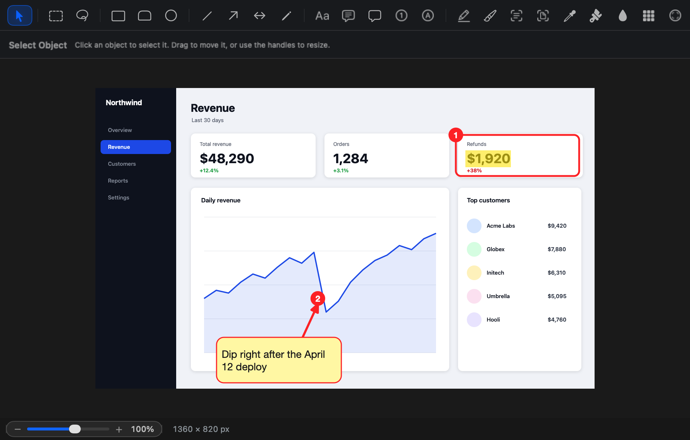
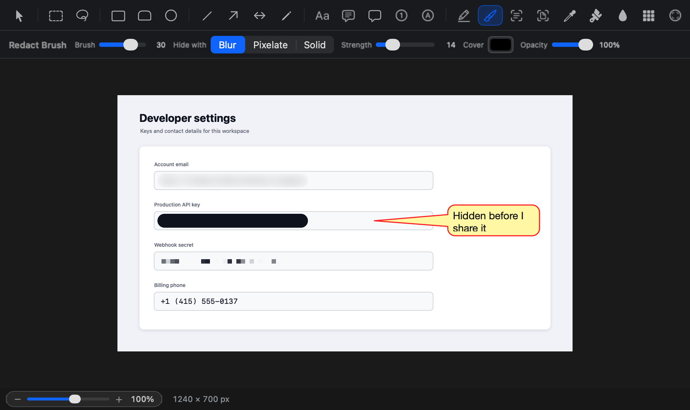
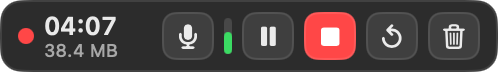
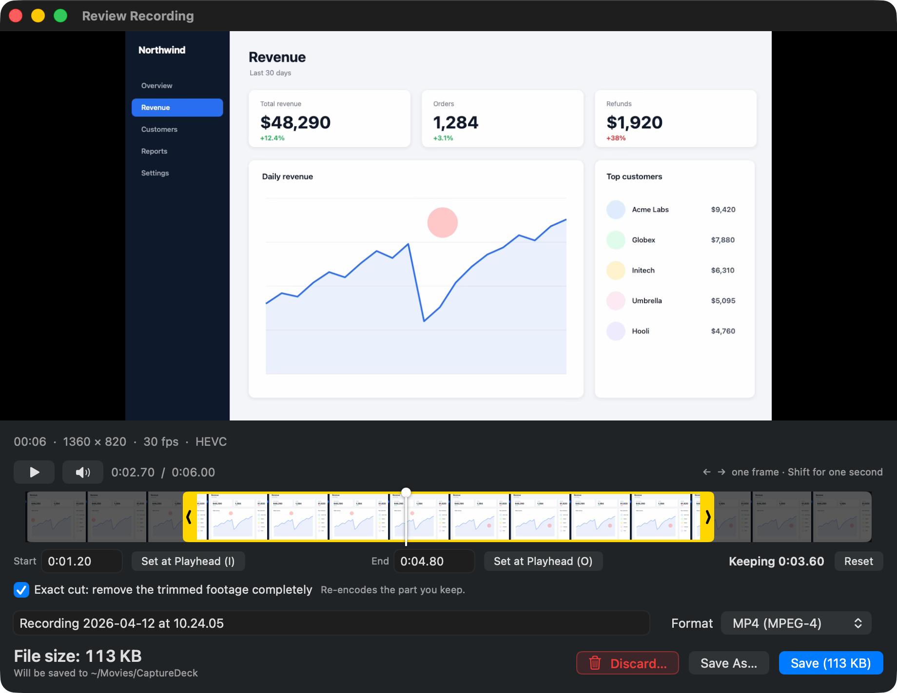
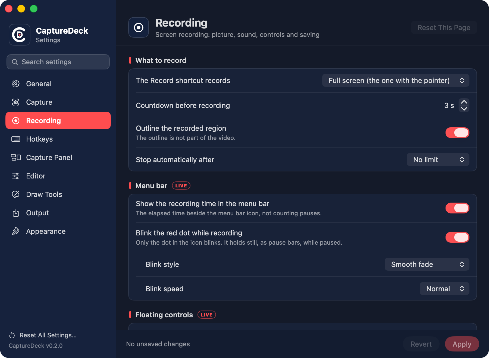

  

<h1 align="center">CaptureDeck User Guide</h1>

Everything you need to capture, mark up and record your screen. This guide is for <b>version 0.2.0</b> on macOS 13 or later.

---

## Contents

1. [Get set up](#1-get-set-up)
2. [Your first screenshot](#2-your-first-screenshot)
3. [Where to find things](#3-where-to-find-things)
4. [Taking screenshots](#4-taking-screenshots)
5. [Scrolling capture](#5-scrolling-capture)
6. [The editor](#6-the-editor)
7. [Hiding private information](#7-hiding-private-information)
8. [Copying text from pictures (OCR)](#8-copying-text-from-pictures-ocr)
9. [Picking colors and filling areas](#9-picking-colors-and-filling-areas)
10. [Saving and sharing images](#10-saving-and-sharing-images)
11. [Recording your screen](#11-recording-your-screen)
12. [Reviewing and trimming a recording](#12-reviewing-and-trimming-a-recording)
13. [Settings](#13-settings)
14. [Shortcut cheat sheet](#14-shortcut-cheat-sheet)
15. [If something goes wrong](#15-if-something-goes-wrong)
16. [Your privacy](#16-your-privacy)

**Reading the keys:** `⌃` Control · `⇧` Shift · `⌥` Option · `⌘` Command · `↩` Return

---

## 1. Get set up

### Install

1. Download **CaptureDeck.dmg** from the [Releases page](https://github.com/jhrahman/CaptureDeck/releases).
2. Open it and drag **CaptureDeck** into **Applications**.
3. Open CaptureDeck. Its icon appears in the menu bar at the top of your screen.

CaptureDeck is not notarized by Apple yet, so macOS may stop it the first time. If it does, right-click the app, choose **Open** and confirm. If your Mac offers no **Open** button, go to **System Settings > Privacy & Security**, scroll down and choose **Open Anyway**.

### Allow what it needs

macOS asks before an app may see or control your screen. CaptureDeck asks only when a feature needs it.

| Permission | What it is for | Needed? |
| --- | --- | --- |
| **Screen Recording** | Taking screenshots and recording the screen | Yes |
| **Accessibility** | Scrolling capture, picking buttons and panels inside a window, showing key presses in recordings, and placing the recording controls beside the Dock | Only for those |
| **Microphone** | Recording your voice | Only if you turn the microphone on |

To change these later, open **System Settings > Privacy & Security**. If a new permission does not seem to work, quit CaptureDeck and open it again.

---

## 2. Your first screenshot

1. Press `⌃⇧2`.
2. Drag a box around what you want.
3. Let go.

The picture is now **on your clipboard** and **open in the editor**. Paste it anywhere with `⌘V`, or add arrows and text first.

> **Changed your mind?** Press `Esc` while selecting.

---

## 3. Where to find things

**The menu bar icon** is home base. Click it to take any kind of capture, start a recording, open an image, show the capture panel or open **Settings…**.

  

**The capture panel** is a small floating toolbar with a button for each kind of capture and for recording.

- Drag it by its background to move it.
- Show or hide it with `⌃⇧0`.
- Drop an image file onto it to open the file in the editor.
- Choose its buttons, size and see-through level in **Settings > Capture Panel**.

---

## 4. Taking screenshots

Before most captures, the screen **freezes**, so menus and moving content hold still while you choose.

| What you want | Shortcut | How it works |
| --- | --- | --- |
| **Full Screen** | `⌃⇧1` | Captures the screen your pointer is on. |
| **Region** | `⌃⇧2` | Drag a box around anything. |
| **Active Window** | `⌃⇧3` | The front window gets a red frame. Click it to capture it. |
| **Window / Object** | `⌃⇧4` | Point at a window, or at a part inside it, then click. |
| **Freehand Region** | `⌃⇧5` | Draw any shape. Everything outside it is see-through. |
| **Fixed Size** | `⌃⇧6` | A box of an exact pixel size follows the pointer. Click to capture. |
| **Repeat Last** | `⌃⇧8` | Captures the same screen, area or window again, as it looks now. |
| **All Displays** | `⌃⇧9` | Captures every screen in one picture. |
| **Capture Text (OCR)** | `⌃⇧T` | Copies the words in a box you drag. See [OCR](#8-copying-text-from-pictures-ocr). |
| **Scrolling Window** | `⌃⇧S` | Captures a long page. See [Scrolling capture](#5-scrolling-capture). |

You can change any shortcut in **Settings > Hotkeys**.

### Keys while selecting

**Region**

| Key | What it does |
| --- | --- |
| Arrow keys | Nudge the corner you are dragging (`⇧` for bigger steps) |
| `Tab` | Switch to the opposite corner |
| `↩` | Accept the box |
| `⌘Z` | Start the selection again |
| `Esc` | Cancel |

**Fixed Size**

| Action | What it does |
| --- | --- |
| Right-click | Choose a preset size |
| Arrow keys | Move the box (`⌥` for bigger steps) |
| `⇧` + arrow keys | Make the box wider, narrower, taller or shorter |
| `↩` or click | Capture |

**Window / Object:** press `↑` to select the surrounding part and `↓` to go back inside.

> **Need time to open a menu?** Set **Settings > Capture > Delay before capturing** to a few seconds.

**Several screens?** All Displays captures label each one "Screen 1", "Screen 2" and so on. Turn the labels off in **Settings > Capture** to join the screens edge to edge.

---

## 5. Scrolling capture

Use this for a web page, chat or document that is longer than the window.

1. Press `⌃⇧S`.
2. Move over the window you want. It gets a red frame.
3. Click it. CaptureDeck scrolls it for you, **down**, or **sideways** if that is how the page moves.
4. Stop it in whichever way is easiest:
   - click inside the window again, or
   - click **Done** in the small panel at the top, or
   - press `↩` or `⌃⇧S` again.

To throw it away, click **Cancel** or press `Esc`. It also stops by itself at the end of the page.

**Good to know**

- Your mouse stays free while it scrolls.
- If scrolling feels too quick, change **Settings > Capture > Scrolling speed**.
- If CaptureDeck cannot scroll a window, the panel asks you to **scroll it yourself**. Scroll at a gentle pace and it follows you.
- If links light up in your picture, move the pointer off the page.
- Very long pages stop at 30,000 pixels or 120 screens.

---

## 6. The editor

  

The editor has three parts: the **tool ribbon** along the top, the **options bar** under it, and your picture. The options bar changes to show what the current tool can do.

Press a tool's letter to switch to it. `Tab` moves to the next tool, and `Esc` leaves a drawing tool.

### Select and crop

| Tool | Key | Use it to |
| --- | --- | --- |
| Select Object | `V` | Click something you added, then move, resize or restyle it |
| Rectangle Select | `S` | Select an area to crop, copy, delete or fill |
| Freehand Select | `F` | Select any shape |

**Quick crop:** a new capture opens with everything selected. Drag an edge or corner inward and let go. Made a mistake? Press `⌘Z`.

With an area selected, the options bar offers **Crop**, **Copy**, **Copy Text**, **Delete** and **Fill**. For a rectangle, the arrow keys move it, `⇧` + arrows change its size, and `⌥` makes bigger steps.

### Draw and explain

| Tool | Key | Tool | Key |
| --- | --- | --- | --- |
| Rectangle | `R` | Text | `T` |
| Rounded Rectangle | `U` | Speech Bubble | `C` |
| Ellipse | `O` | Oval Bubble | `Q` |
| Line | `L` | Step Number (1, 2, 3) | `N` |
| Arrow | `A` | Step Letter (A, B, C) | `K` |
| Double Arrow | `D` | Highlighter | `H` |
| Pencil | `P` | Spotlight (dims everything else) | `G` |
| | | Magnifier (enlarges a spot) | `M` |

**Tips**

- Hold `⇧` while dragging to make a perfect square or circle, or to snap lines to 45°.
- Double-click text or a bubble to edit it. `↩` starts a new line; `Esc` finishes.
- You can move most things without changing tools: just drag them. With the Pencil, Redact Brush or Hide Text, switch to **Select Object** (`V`) first.

### Change what you added

| Action | How |
| --- | --- |
| Move a little | Arrow keys (`⌥` for bigger steps) |
| Delete | `⌫` |
| Duplicate | `⌘J` |
| Bring to front / send to back | `⌥⌘]` / `⌥⌘[` |
| More choices | Right-click the object |
| Undo / redo | `⌘Z` / `⇧⌘Z` |

### Change the whole picture

Use the **Image** menu: rotate right (`⌘R`) or left (`⌘L`), rotate by any angle, flip, **Resize Image** (`⇧⌘R`), **Canvas Size** (`⇧⌘C`), or quickly resize to 25, 50, 75 or 200% (`⌃⌘1` to `⌃⌘4`).

**Zoom:** `⌘=` in, `⌘-` out, `⌘9` fit to window, `⌘0` actual size.

---

## 7. Hiding private information

  

> **For real secrets, such as passwords, keys and account numbers, use Solid.** Blurred or pixelated text can sometimes be worked out. A solid cover shows nothing.

### Hide Text (`W`): the quickest way

CaptureDeck reads the words in your picture, on your Mac.

1. Choose **Hide Text** and wait a moment while it reads.
2. Click a word to cover it.
   - **Drag** across several words to cover them all.
   - **`⌥`-click** or **double-click** to cover a whole line.
   - Click **Hide All Text** to cover everything it found.
3. Pick **Blur**, **Pixelate** or **Solid** in the options bar.

Always look over the result: text recognition can miss words.

### Other ways

| Tool | Key | Best for |
| --- | --- | --- |
| Redact Brush | `E` | Painting over faces, pictures or odd shapes |
| Blur | `B` | Blurring a rectangle |
| Pixelate | `X` | Pixelating a rectangle |

---

## 8. Copying text from pictures (OCR)

CaptureDeck can read the words in a screenshot, so you can copy them instead of retyping. Reading happens **on your Mac**.

### Capture Text: straight from the screen

1. Press `⌃⇧T`.
2. Drag a box around the words.
3. Let go. The text is on your clipboard, ready to paste.

No picture is saved. It also reads **QR codes and barcodes** inside the box, and copies what they hold. A link from a code is **never opened for you**. Check it before you visit it.

To see and correct the text first, set **Settings > Capture > Capture Text (OCR) > After capturing text** to show it.

### Extract Text (`J`): inside the editor

Choose the **Extract Text** tool. Every line it finds is outlined, and codes are outlined in orange.

| To | Do this |
| --- | --- |
| Copy one line or code | Click it |
| Copy part of the picture | Drag a box around it |
| Copy everything | **Copy All Text** |
| Read it over and correct it | **View & Edit…**, then **Copy Text** (`⌘↩`) or **Save as Text File…** |
| Make a PDF you can search | **Save PDF…** |

### Other ways

- **A selected area:** select it, then click **Copy Text** in the options bar.
- **Menu:** **Image > Copy Text from Picture** (`⇧⌘T`), **View Text in Picture…** or **Save as Searchable PDF…**. The first two use your selection if you have one.
- **An image file:** open it in the editor, then use any of the ways above.

A **searchable PDF** looks just like your picture, but you can search, select and copy its words.

### Covered text stays covered

In the editor, text is read from the picture **as you see it**. Words hidden behind a **solid** cover cannot be read, copied or put into a PDF. Blurred or pixelated words may still be partly readable, so use **Solid** for secrets.

> This applies to CaptureDeck's editing. **Capture Text** reads whatever is visible on your screen inside the box you drag.

### Get better results

Set these in **Settings > Editor > Text recognition (OCR)**. They apply to Capture Text too.

| Setting | What it does |
| --- | --- |
| **Language** | Automatic usually works. Choose a language if words are misread. |
| **Keep line breaks** | Turn off to join the lines of each paragraph. |
| **Correct spelling** | Helps ordinary writing. Leave it off for code, names and numbers. |

Always check important numbers, names and codes: reading text from pictures can make mistakes. Text in **side-by-side columns** is read straight across, so copy one column at a time by dragging a box around it.

---

## 9. Picking colors and filling areas

### Set the color of anything

Every color box works the same way:

- **Click** it to choose from the palette.
- **Right-click** it, or choose **Pick from screen**, to take a color from anywhere on your screen.

While using a drawing tool, you can also hold `⌥` and click the picture to borrow its color.

### Pick Color (`Y`): find a color's values

1. Choose **Pick Color**. A magnifier follows your pointer.
2. Click the exact pixel you want.
3. The options bar shows the color with its **HEX** and **RGB** values. From there you can:
   - **Copy HEX** or **Copy RGB**
   - **Fill with this color**, which takes you to the Paint Bucket
   - **Pick from screen**, for a color outside the picture

### Paint Bucket (`I`): fill an area of similar color

1. Choose **Paint Bucket**.
2. Set **Fill color**.
3. Move over the picture. A preview shows what will be filled.
4. Click.

| Option | What it does |
| --- | --- |
| **Tolerance** | Raise it to include more shades. Lower it if too much gets filled. |
| **Opacity** | Makes the fill see-through. |
| **Transparent** | Choose it as the fill color to erase the area. A checkerboard shows the empty part. Opacity does not apply here. |

**To fill a box instead:** select it with **Rectangle Select**, check the color box next to **Fill**, then click **Fill**.

---

## 10. Saving and sharing images

| To | Do this |
| --- | --- |
| Copy the picture, or just the selected area | `⌘C` |
| Save | `⌘S` |
| Save as a new file or another format | `⇧⌘S` |
| Open an image file | `⌘O`, or drop it onto the capture panel |
| Edit an image from the clipboard | Menu bar icon > **Edit Image from Clipboard**, or `⌘V` in the editor |
| Close the current tab | `⌘W` |

- Images can be saved as **PNG**, **JPEG** or **TIFF**.
- Each capture opens in its own tab.
- To save every screenshot automatically, turn on **Settings > Capture > Save the image to a file automatically**.
- Choose the folder, format and file names in **Settings > Output**.
- A file you opened from your disk is not overwritten unless you turn that on in **Settings > Editor**.

### Name your files your way

In **Settings > Output > File name**, use these codes:

| Code | Becomes | Code | Becomes |
| --- | --- | --- | --- |
| `$Y` | Year | `$h` | Hour |
| `$M` | Month | `$m` | Minute |
| `$D` | Day | `$s` | Second |
| `####` | A counter: 0001, 0002… | | |

---

## 11. Recording your screen

### Record in three steps

1. Press `⌃⇧R`. A 3-second countdown starts.
2. Do what you want to show.
3. Press `⌃⇧R` again to stop. The [review window](#12-reviewing-and-trimming-a-recording) opens.

To call it off during the countdown, click the countdown, press `Esc` or press `⌃⇧R`.

### Choose what to record

From the menu bar icon, choose:

| Choice | What gets recorded |
| --- | --- |
| **Record Full Screen** | The screen your pointer is on |
| **Record Region** | A box you drag |
| **Record Window** | A window you click |
| **Record Last Region** | The same box as last time |

To choose what `⌃⇧R` records, use **Settings > Recording > What to record**. You can also give each choice its own shortcut in **Settings > Hotkeys**.

### While recording

  

The floating controls sit at the bottom left, beside the Dock when there is room. **They never appear in your video.**

| Control | What it does |
| --- | --- |
| Time and size | How long you have recorded, and the size so far |
| Microphone | Mute or unmute (shown when the microphone is on) |
| Pause (`⌃⇧P`) | Pause and resume. Paused time is left out of the video. |
| Stop (`⌃⇧R`) | Finish and review |
| Start over | Throw this take away and begin again |
| Discard | Throw the recording away |

**Start over** and **Discard** ask for a second click. A bar shows how long you have: about 3 seconds. **Mini** size shows only the time, pause and stop.

The **menu bar icon** also shows what is happening: a blinking red dot while recording, and pause bars while paused. If you record the part of the screen with the menu bar, the icon appears in your video too.

### Sound

In **Settings > Recording > Audio**:

- **Record the Mac's sound** is on to start with. When you record one window, you still get all of your Mac's sound, not only that window's.
- **Record the microphone** is off to start with. Wear headphones, or the microphone also picks up your speakers.
- Both are combined into one track, so they play everywhere. For video editing, you can keep them as two tracks.

> **Before an important recording,** make a short test and play it back to check the sound.

### Help viewers follow along

In **Settings > Recording > Mouse pointer, clicks and keys**:

| Option | What viewers see |
| --- | --- |
| **Record the mouse pointer** | Your pointer. Turn off to hide it. |
| **Circle around the pointer** | A colored circle that follows the mouse. Choose its color, size and style. |
| **Animate mouse clicks** | A ripple on each click, with separate left and right colors |
| **Show pressed keys** | **Shortcuts and special keys only** hides ordinary typing. **Every key** shows what you type. |

Keys are not shown while a password field is active. With **Every key**, anything else you type appears in the video, so use it with care.

If you are recording **one window** and want any of these, turn one on **before** you start.

### Quality settings

The starting settings suit most recordings. If you want to change them:

| Setting | Choices | Advice |
| --- | --- | --- |
| **Frame rate** | 15 to 120 fps | 60 is smooth. 30 makes smaller files. Your screen limits the highest rate. |
| **Video codec** | HEVC, H.264, ProRes | HEVC gives small files. H.264 plays on more devices. ProRes is for editing and makes huge files. |
| **Quality** | Compact to Maximum | **High** keeps text crisp. |
| **Sharper colored text** | On or off | Helps small colored text. Larger files, and some devices cannot play them. |
| **Resolution** | Native or Standard | Native keeps every screen pixel. Standard makes smaller files. |
| **Frame timing** | Variable or Constant | Use Constant if your video editor needs it. |

Standard video compression is not mathematically lossless, even when it looks sharp.

### Safety nets

- If CaptureDeck or your Mac closes unexpectedly, the recording is offered back when CaptureDeck next opens. The last few seconds may be missing.
- Quitting during a recording finishes it first, and offers it at the next launch.
- You need at least **1 GB** of free space to start. If space runs very low, recording stops and keeps what it has.
- You can set an automatic time limit in **Settings > Recording > What to record**.

---

## 12. Reviewing and trimming a recording

  

### Trim

- **Drag the yellow handles** to choose the part to keep.
- **Click or drag** anywhere else on the timeline to move through the video.
- Or **type** a Start or End time, such as `12.5` or `1:30.25`, and press `↩`.

| Key | What it does |
| --- | --- |
| `Space` | Play or pause the part you are keeping |
| `I` / `O` | Set the start / end where the playhead is |
| `←` `→` | Move one small step (1/30 second) |
| `⇧` + `←` `→` | Move one second |
| `⌘S` | Save |

### Exact cut

**Exact cut** is on to start with. It removes the trimmed footage completely from your MP4 or MOV file. This takes a little longer, because the part you keep is encoded again.

> **Warning:** if you turn Exact cut off, saving is faster, but **hidden footage from outside your trim can stay inside the file** and may be recovered. Keep it on if you are trimming away anything private.

### Choose a format

| Format | Best for |
| --- | --- |
| **MP4** | Sharing: the most widely supported choice |
| **MOV** | QuickTime and Mac video editors |
| **GIF** | Short, silent clips, 90 seconds or less |

ProRes recordings can be saved as MOV or GIF.

### Check the size, then save

The window shows the **file size** of the file it has prepared, so you know it before saving. It updates when you trim or change format.

- **Save** puts the file in your recordings folder, normally **Movies/CaptureDeck**.
- **Save As…** lets you choose another place.
- **Discard…** deletes the recording after asking you.

After saving, you can **Show in Finder** or **Copy File**, then paste it into a chat or email.

Prefer to skip this window? Turn off **Settings > Recording > Saving > Review before saving**. If there is a problem with a recording, the window still opens.

---

## 13. Settings

Open **Settings…** from the menu bar icon.

  

1. Choose a page in the sidebar, or press `⌘F` and **search**. For example, type `sound` or `color`.
2. Make your changes. Changed settings are marked in orange.
3. Click **Apply**. Nothing changes until you do.

**Revert** forgets changes you have not applied. **Reset This Page** and **Reset All Settings…** prepare the default values; click **Apply** to use them.

Groups marked **LIVE** can be changed during a recording. A few items in them wait until the next recording, and their descriptions say so.

| Page | What you will find |
| --- | --- |
| **General** | Start at login, start in the menu bar only, capture sound |
| **Capture** | What happens after a screenshot or text capture, delay, magnifier, scrolling speed |
| **Recording** | What to record, menu bar, floating controls, video, audio, pointer and keys, saving |
| **Hotkeys** | All global shortcuts. Click one, then press the new keys. `⌫` clears it; `Esc` cancels. |
| **Capture Panel** | Show or hide, see-through level, size and buttons |
| **Editor** | Cropping, saving, starting tool, text recognition and resizing |
| **Draw Tools** | The starting color and style of each tool |
| **Output** | Screenshot folder, file name and format |
| **Appearance** | Light, dark, or the same as your Mac |

---

## 14. Shortcut cheat sheet

### Works from any app

| Shortcut | Action |
| --- | --- |
| `⌃⇧1` | Full Screen |
| `⌃⇧2` | Region |
| `⌃⇧3` | Active Window |
| `⌃⇧4` | Window / Object |
| `⌃⇧5` | Freehand Region |
| `⌃⇧6` | Fixed Size |
| `⌃⇧8` | Repeat Last Capture |
| `⌃⇧9` | All Displays |
| `⌃⇧S` | Scrolling Window (press again to finish) |
| `⌃⇧T` | Capture Text (OCR) |
| `⌃⇧0` | Show or hide the capture panel |
| `⌃⇧R` | Start or stop recording |
| `⌃⇧P` | Pause or resume recording |

### Editor tools

`V` Select Object · `S` Rectangle Select · `F` Freehand Select · `R` Rectangle · `U` Rounded Rectangle · `O` Ellipse · `L` Line · `A` Arrow · `D` Double Arrow · `P` Pencil · `T` Text · `C` Speech Bubble · `Q` Oval Bubble · `N` Step Number · `K` Step Letter · `H` Highlighter · `E` Redact Brush · `W` Hide Text · `J` Extract Text · `Y` Pick Color · `I` Paint Bucket · `B` Blur · `X` Pixelate · `G` Spotlight · `M` Magnifier

---

## 15. If something goes wrong

| Problem | What to try |
| --- | --- |
| **Screenshots or recording do not work** | Allow **Screen Recording** in System Settings > Privacy & Security, then quit and reopen CaptureDeck. |
| **A shortcut does nothing** | Another app may be using it. Look for a note under it in **Settings > Hotkeys**, and choose a different one. |
| **Scrolling capture does not scroll** | Allow **Accessibility**. If the panel asks, scroll the page yourself. |
| **Scrolling capture stops early** | The page may have changed while scrolling. Let it finish loading, then try again at a slower speed. |
| **No Mac sound in a recording** | Check **Record the Mac's sound**, and play your video's sound while testing. |
| **No microphone sound** | Turn on **Record the microphone**, choose the right microphone, and allow it in System Settings. Check the mute button. |
| **The video will not play on another device** | Use **H.264** and turn off **Sharper colored text** for your next recording. |
| **Colored text looks soft** | Turn on **Sharper colored text**, and use **Native** resolution. |
| **"Frames dropped" appears** | Try a lower frame rate and close busy apps. |
| **The file is too big** | Trim it, or next time use 30 fps, **Balanced** or **Compact** quality, or **Standard** resolution. |
| **OCR misreads words** | Choose the language in Settings > Editor > Text recognition, and capture the text larger if you can. |
| **OCR finds no text** | Zoom in on the page before capturing, or drag a tighter box around clear text. |
| **Key presses are not shown** | Turn on **Show pressed keys** and allow **Accessibility**. |
| **The recording controls are hidden** | Check **Show the floating controls**. You can always use `⌃⇧R` or the menu bar icon. |
| **The app icon looks dark** | macOS can restyle icons to match your icon style in System Settings > Appearance. |

Still stuck? [Open an issue](https://github.com/jhrahman/CaptureDeck/issues) and say what you did, what you expected and what happened. Remove anything private from screenshots first.

---

## 16. Your privacy

- CaptureDeck works **on your Mac**. It has no account, no analytics and no network code.
- Reading text, for **OCR** and **Hide Text**, also happens on your Mac. Links in QR codes are never opened automatically.
- Screenshots go to your clipboard, and to a folder if you save them. Other apps and clipboard syncing features may be able to read what you copy.
- Unsaved recordings are kept in CaptureDeck's own folder until you save or discard them.
- Before you share anything, look over the whole picture or watch the whole video.

---

<a href="#contents">Back to the top</a> · <a href="README.md">About CaptureDeck</a>

